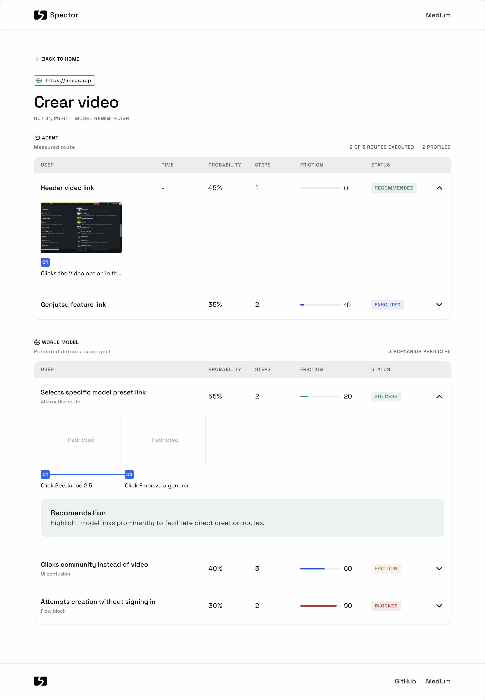
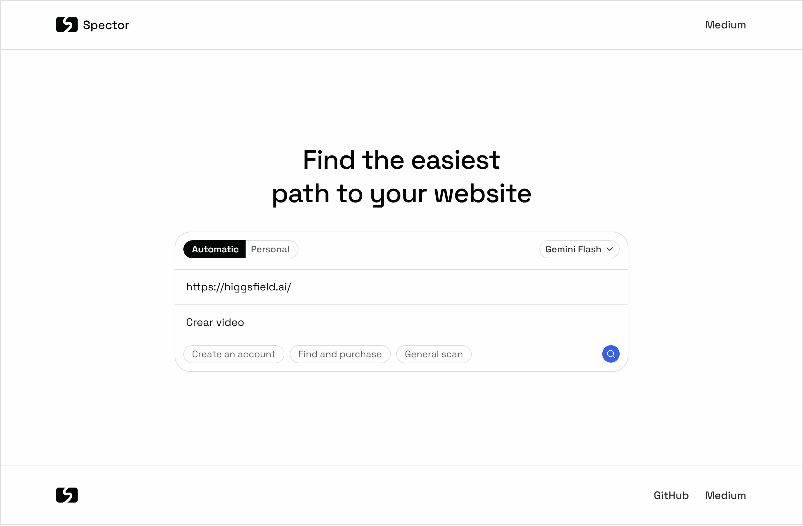

# Spector

Find UX friction on a website before your users do.



Spector takes a URL and a goal "create an account", "see the pricing plans" then
walks the site with a real browser to measure what actually happens, and uses a world
model to predict what could go wrong along the way.



## What it does

Checking that the happy path works is the easy part. A good experience also depends on
what the interface does when someone mistypes an email, misreads a label, or tries
something you didn't plan for.

Spector looks at both:

- **The agent** walks the site with Playwright, step by step, and measures the route it
  actually took.
- **The world model** branches from what the agent saw and predicts the detours — the
  confusions, the errors, the dead ends — without navigating each one.

The two stay visually separate in the report, so what happened is never confused with
what might happen.

Built for developers and designers who want a read on their own flows without running a
user test for every change. Especially useful on output from tools like Lovable, v0 or
Framer, where the interface exists before anyone has stress-tested it.

It doesn't replace testing with real people. It tells you where to look first.

## Reading the report

Each route carries a status, and the difference between them matters:

| Status | What it means |
|---|---|
| `RECOMMENDED` | The agent walked it, arrived, and evidence confirmed it |
| `EXECUTED` | Walked and arrived, but another route scored better |
| `UNVERIFIED` | The model says it arrived; no evidence confirmed it. Can't be recommended |
| `CONTINUES` | The flow leaves what Spector can follow. Not broken measurement stops there |
| `FRICTION` | A predicted scenario where the user struggles but gets through |
| `BLOCKED` | A predicted scenario where the user can't continue |

Friction from the agent is measured. Friction from the world model is predicted — the
ranking between scenarios is reliable, the exact number is not.

## Setup

You need Node.js 20+ and a Gemini API key, free from
[Google AI Studio](https://aistudio.google.com/apikey).

```bash
git clone https://github.com/jonnygcc/spector-worldmodel.git
cd spector-worldmodel
npm install
cp .env.example .env.local   # then add your key to GEMINI_API_KEY
npm run dev
```

Open http://localhost:3000. A full analysis takes 20 to 60 seconds.

## Limitations

Worth knowing before you file a bug:

**Public sites only.** Spector refuses `localhost`, private IP ranges and non-standard
ports. This is deliberate: the tool opens any URL you hand it, so without that
restriction a malicious page could use your own instance to read local files.

**Flows that leave the site are not followed.** A checkout that hands off to Stripe, or
a signup that opens a Google OAuth popup, reports `CONTINUES` and stops there. The route
isn't marked as failed, but nothing past the handoff is measured.

**World model numbers are predictions, not measurements.** Re-running the same page and
goal returns the cached result, so a number won't change under you. But a fresh
prediction of the same page can land somewhere noticeably different — read them as a
signal of which scenarios deserve a look, not as a score to track over time.

**Bot detection stops the agent.** Sites behind Cloudflare, reCAPTCHA or similar may
block the browser before it gets anywhere.

**Quota.** One analysis makes roughly 12 calls to Gemini. The free tier allows 15 per
minute and 500 per day, so back-to-back runs will hit the limit. Spector says so instead
of failing silently. Re-running the same page and goal is free — the prediction is
cached.

**The model selector is not wired yet.** The dropdown shows where the project is going;
today every analysis runs on Gemini Flash.

## How it works

```
URL + goal
    │
    ├─ Agent        Playwright walks the site, step by step, with screenshots.
    │               Friction here is measured from what happened.
    │
    └─ World model  Takes the first state the agent captured and branches from it.
                    Predicts alternative routes, user errors and interface confusions
                    — all toward the same goal — without navigating them.
```

Every URL that reaches the browser passes a validator, and the browser only reaches the
network through a proxy that re-checks every connection, including redirects. Page
content is passed to the model as data, never as instructions.

**Stack:** Next.js 16 (App Router) · Tailwind CSS · Playwright · Google Gemini Flash

## Background

Spector grew out of [WebDreamer](https://arxiv.org/abs/2411.06559) (OSU NLP, TMLR 2025),
which explores using LLMs to anticipate what happens during web navigation, and from
earlier work by David Ha and Jürgen Schmidhuber on
[exploring scenarios inside a simulated environment](https://worldmodels.github.io/)
before acting in the real one.

## Contributing

The idea has more in it than one person can explore. Issues and pull requests are
welcome, and so is forking it and taking it somewhere else entirely.

## License

MIT